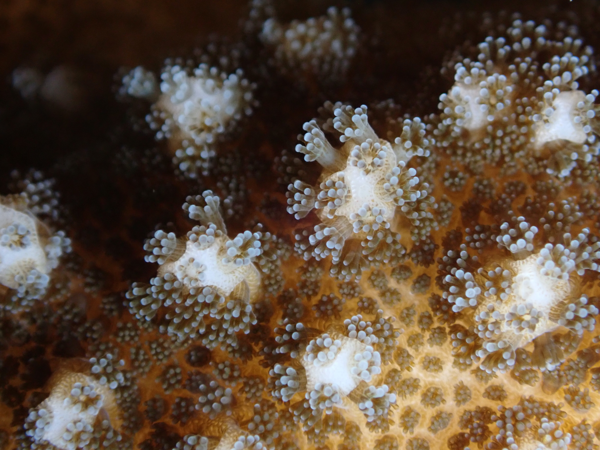

<section class="cover-hero" aria-labelledby="research-question">

Evolutionary biology · Comparative genomics · Marine conservation

<h1 id="research-question">How is marine biodiversity generated and maintained?</h1>

</section>

<section class="intro-panel" aria-labelledby="intro-heading">

My research

<h2 id="intro-heading">I use genomics to understand the origins and persistence of marine biodiversity.</h2>

I am an evolutionary biologist working at the intersection of comparative genomics, phylogenomics, and marine conservation. My research uses cnidarians - corals and jellyfish - as model systems to investigate how new cell types evolve, how marine species diversify, and how interactions between animals and their microbial partners shape life in the ocean.

Postdoctoral Researcher · National Human Genome Research Institute, National Institutes of Health

<a class="button-link" href="./cv.html">CV</a>
<a class="text-link" href="./contact.html">Contact →</a>

</section>

<section class="research-overview">

Research themes

<h2>Understanding biodiversity across biological scales</h2>

My work connects evolutionary processes within organisms to the ecological and evolutionary dynamics that shape marine communities.

<article class="research-card">

Cell-type evolution

<h3>How did animal cells and tissues evolve?</h3>

At NHGRI, I study the hydrozoan <em>Podocoryna</em> using genome resources and single-cell RNA sequencing to investigate cell-type diversity, differentiation, and the evolution of specialized tissues such as striated muscle.

<a href="./projects.html#podocoryna">Explore this research →</a>

</article>

<article class="research-card">

Biodiversity & conservation

<h3>What processes drive speciation in marine invertebrates?</h3>

I apply phylogenomics and museum genomics to resolve species boundaries in <em>Pocillopora</em> corals, connecting evolutionary history to coral distributions and conservation.

<a href="./projects.html#coral-diversity">Explore this research →</a>

</article>

<article class="research-card">

Host–microbe interactions

<h3>How do symbioses shape animal biology?</h3>

My work investigates how host-associated bacteria and other microbes impact host physiology, immune responses, and evolutionary diversification.

<a href="./projects.html#host-microbes">Explore this research →</a>

</article>

</section>

## Selected publications

2026

<strong>A chromosome-level reference genome for <em>Podocoryna americana</em></strong>
Co-first author · <em>G3: Genes, Genomes, Genetics</em>
<a href="https://doi.org/10.1093/g3journal/jkag160">Read the paper →</a>

2025

<strong>Genome skimming illuminates hidden species diversity and Symbiodiniaceae associations in east Pacific <em>Pocillopora</em> corals</strong>
First author · <em>Genome Biology and Evolution</em>
<a href="https://doi.org/10.1093/gbe/evaf235">Read the paper →</a>

2024

<strong>Unlocking the treasure trove: leveraging dry coral specimens for museum genomics</strong>
First author · <em>Coral Reefs</em>
<a href="https://doi.org/10.1007/s00338-024-02525-5">Read the paper →</a>

2023

<strong>Antibiotics reduce <em>Pocillopora</em> coral-associated bacteria diversity, decrease holobiont oxygen consumption, and activate immune gene expression</strong>
First author · <em>Molecular Ecology</em>
<a href="https://doi.org/10.1111/mec.17049">Read the paper →</a>

## Methods and research toolkit

Comparative genomicsGenome assembly & annotationPhylogenomicsSingle-cell RNA-seqTranscriptomicsHost–microbe systemsMuseum genomicsBioinformatics workflows

I value collaborative, reproducible research that connects computational analyses with biological questions and addresses management and conservation needs. 

<h2>Explore my work</h2>
Browse research projects or get in touch about research and collaboration.

<a href="./projects.html">Research projects</a><a href="./contact.html">Contact</a>

