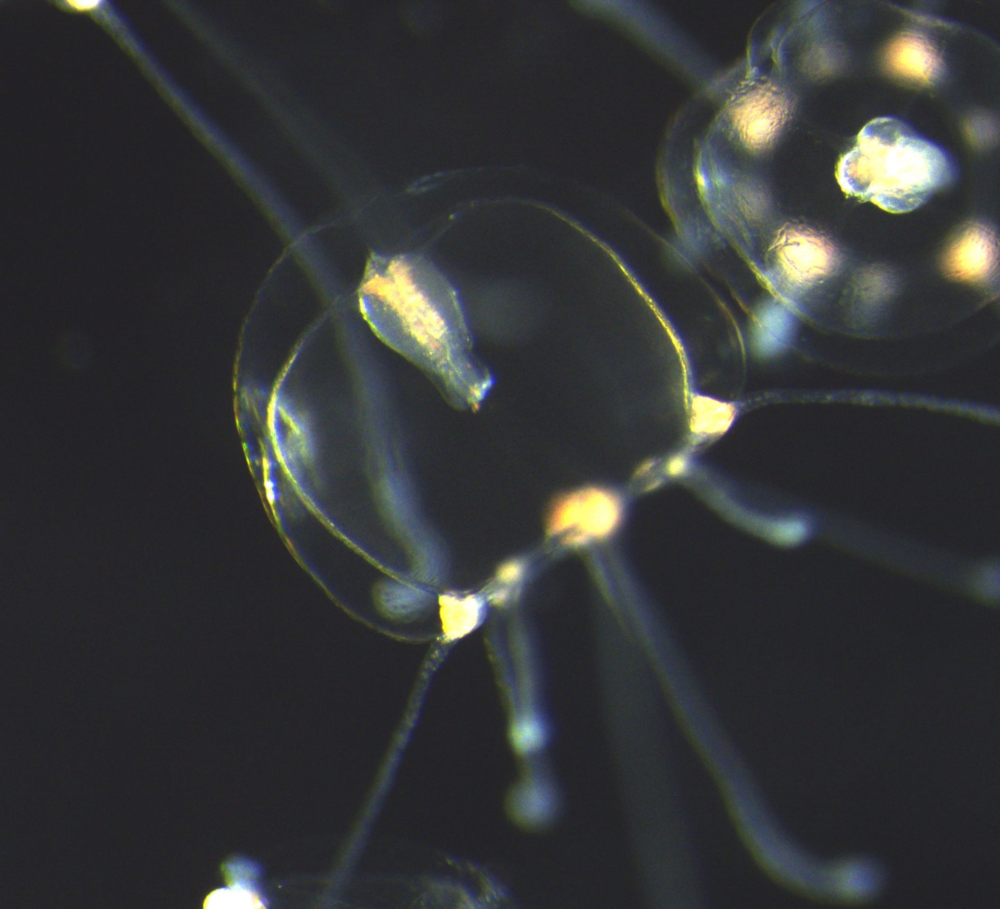
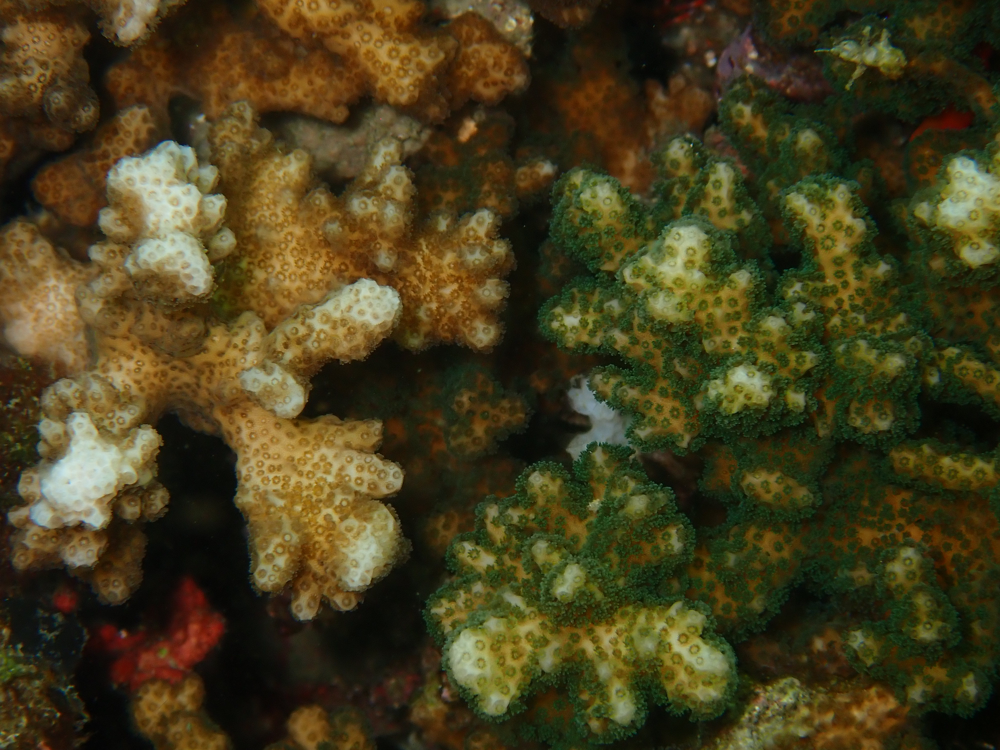
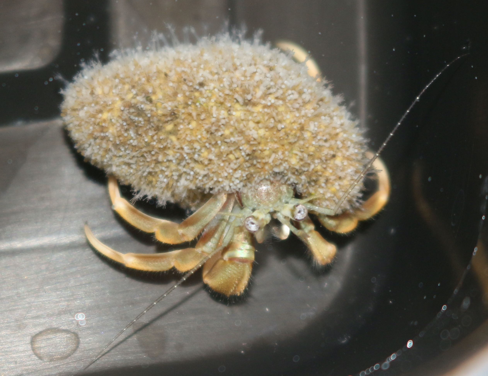

Evolutionary biology · Comparative genomics · Marine conservation

<h1>Michael T. Connelly, Ph.D.</h1>

I use genomics and computational biology to understand how animal diversity evolves—from the origins of cell types in early animals to hidden biodiversity and microbial partnerships in coral reefs.

Postdoctoral Researcher · National Human Genome Research Institute, National Institutes of Health

<a class="button-link" href="./cv.html">View CV</a>
<a class="text-link" href="./publications.html">Selected publications →</a>
<a class="text-link" href="./contact.html">Get in touch →</a>

Research overview

<h2>Answering evolutionary questions with genomic evidence</h2>

My research combines comparative genomics, phylogenomics, and single-cell transcriptomics to investigate how genomes, cells, and symbioses shape animal diversity. I work primarily with cnidarians, such as jellyfish and corals, which offer powerful perspectives on the evolution of animal tissues, regeneration, immunity, and marine biodiversity.

Cell-type evolution

<h3>How did animal cells and tissues evolve?</h3>

At NHGRI, I study the hydrozoan <em>Podocoryna</em> using genome resources and single-cell RNA sequencing to investigate cell-type diversity, differentiation, and the evolution of specialized tissues such as striated muscle.

<a href="./projects.html#podocoryna">Explore this research →</a>

Biodiversity & conservation

<h3>What diversity is hidden in coral reefs?</h3>

I apply phylogenomics and museum genomics to resolve species boundaries in <em>Pocillopora</em> corals, connecting evolutionary history to coral distributions and conservation.

<a href="./projects.html#coral-diversity">Explore this research →</a>

Host–microbe interactions

<h3>How do symbioses shape animal biology?</h3>

My work investigates how coral-associated bacteria and symbiotic algae relate to host physiology, immune responses, and evolutionary diversification.

<a href="./projects.html#host-microbes">Explore this research →</a>

## Selected contributions

2026

<strong>A chromosome-level reference genome for <em>Podocoryna americana</em></strong>
Co-first author · <em>G3: Genes, Genomes, Genetics</em>
<a href="https://doi.org/10.1093/g3journal/jkag160">Read the paper →</a>

2025

<strong>Genome skimming illuminates hidden species diversity and Symbiodiniaceae associations in east Pacific <em>Pocillopora</em> corals</strong>
First author · <em>Genome Biology and Evolution</em>
<a href="https://doi.org/10.1093/gbe/evaf235">Read the paper →</a>

2024

<strong>Unlocking the treasure trove: leveraging dry coral specimens for museum genomics</strong>
First author · <em>Coral Reefs</em>
<a href="https://doi.org/10.1007/s00338-024-02525-5">Read the paper →</a>

2023

<strong>Antibiotics reduce <em>Pocillopora</em> coral-associated bacteria diversity, decrease holobiont oxygen consumption, and activate immune gene expression</strong>
First author · <em>Molecular Ecology</em>
<a href="https://doi.org/10.1111/mec.17049">Read the paper →</a>

## Methods and research toolkit

Comparative genomicsGenome assembly & annotationPhylogenomicsSingle-cell RNA-seqTranscriptomicsHost–microbe systemsMuseum genomicsBioinformatics workflows

I value collaborative, reproducible research that connects robust computational analyses with biological questions and conservation needs. My work has taken me from molecular laboratories and museum collections to coral reefs in the eastern tropical Pacific.

<h2>Explore my work</h2>
Browse research projects, read the publication record, or get in touch about research and collaboration.

<a href="./projects.html">Research projects</a><a href="./publications.html">All publications</a><a href="./contact.html">Contact</a>

