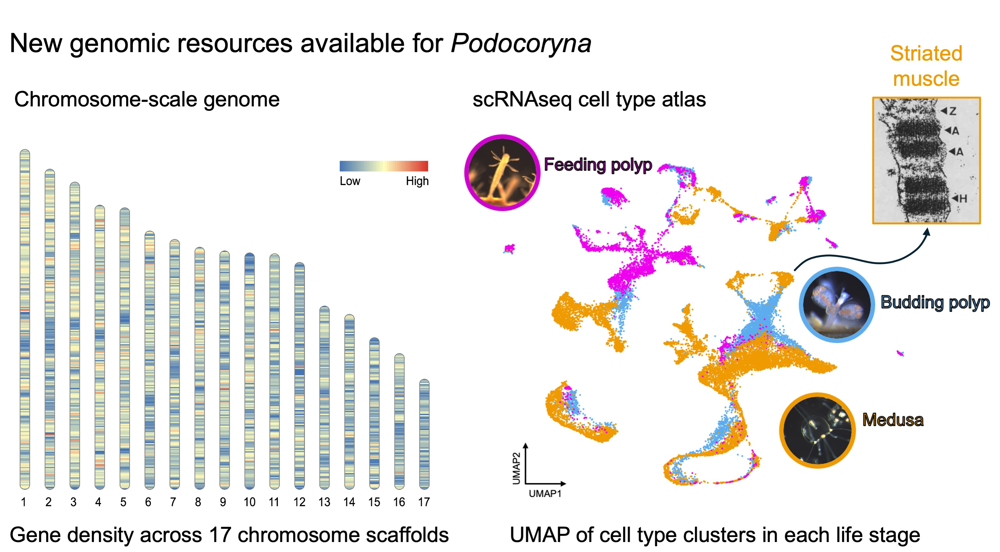
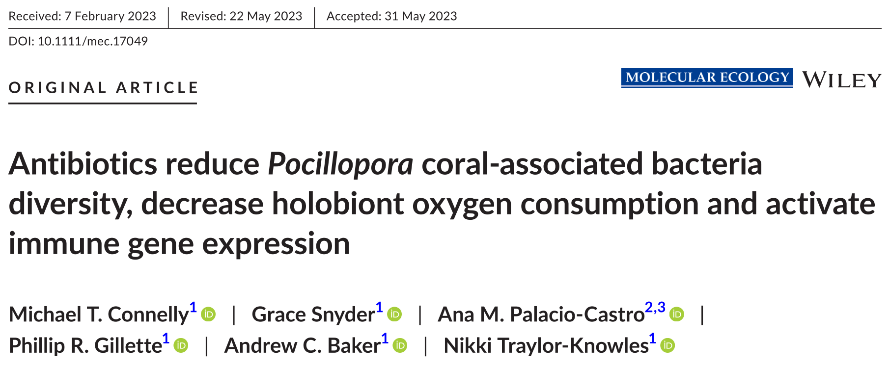

My research uses comparative and population genomics, transcriptomics, and microbial ecology to investigate the evolution of animal cells, coral biodiversity, and host–microbe relationships.

## Cell-type evolution and genomic resources in *Podocoryna*

Current research · NIH / NHGRI

At the National Human Genome Research Institute, I study the colonial hydrozoan *Podocoryna americana*, an emerging model for understanding regeneration, cell differentiation, and the evolution of specialized tissues. This work combines reference-genome development with single-cell RNA sequencing across life stages to characterize cellular diversity and investigate the evolutionary origins of tissues such as striated muscle.

  
  
Genome resources and a single-cell atlas can support comparative studies of cnidarian cell types and tissue evolution.

**Questions and approaches**
- How are cell types distributed across the *Podocoryna* life cycle?
- What can comparative genomics reveal about the evolution of muscle and other specialized cell types?
- How can genome annotation and single-cell transcriptomics provide a reusable foundation for cnidarian research?

**Methods:** genome assembly and annotation, comparative genomics, single-cell RNA-seq, differential expression, gene ontology enrichment, and orthology-based analyses.

## Hidden species diversity in eastern Pacific *Pocillopora* corals

Smithsonian Biodiversity Genomics Fellowship · 2021–2023

I investigated species boundaries and evolutionary relationships in *Pocillopora*, a widespread and ecologically important genus of reef-building corals. Across the eastern tropical Pacific, genomic data can reveal lineages that are difficult to distinguish by morphology alone. This research integrates phylogenomics, field collections, morphometrics, and comparisons with historical museum material to improve understanding of coral biodiversity.

  
  
Morphological variation in *Pocillopora* highlights the challenge of connecting visible form with evolutionary lineages.

My first-author study in *Genome Biology and Evolution* used genome skimming to illuminate hidden species diversity and Symbiodiniaceae associations in east Pacific *Pocillopora*. Related museum-genomics work demonstrated the value of dry coral specimens for recovering genomic data from historical collections.

**Questions and approaches**
- Where do genomic species boundaries agree with—or challenge—morphology-based taxonomy?
- How can museum specimens extend the geographic and historical reach of biodiversity genomics?
- How are coral host lineages associated with their symbiotic algae?

**Methods:** genome skimming, phylogenomic analysis, species delimitation, museum genomics, morphometrics, and symbiosis analysis.

## Coral host–microbe interactions, immunity, and physiology

Ph.D. research · University of Miami

For my Ph.D. in the Cnidarian Immunity Laboratory at the University of Miami, I studied how bacterial communities interact with *Pocillopora* coral hosts and influence physiology and immune activity. This work included experiments involving antibiotics, bacterial lipopolysaccharide, and heat stress, as well as transcriptomic analyses of coral responses to disease-related challenges.

  
  
Experimental and transcriptomic approaches help connect microbial community changes with coral host responses.

**Questions and approaches**
- How do perturbations to bacterial communities affect coral physiology and immune gene expression?
- Do coral genotypes differ in their responses to microbial signals?
- How can host and microbiome data be combined to better understand coral health?

**Methods:** experimental microbiome manipulation, microbial community analysis, RNA-seq, differential gene expression, and host–microbe interaction research.

## Additional projects and collaborations

- **Coral conservation genetics:** collaborated on training and workshop activities focused on coral genetics for restoration and conservation with [Raising Coral Costa Rica](https://www.raisingcoral.org/). [Workshop website](https://michaeltconnelly.github.io/RaisingCoral_CoralGeneticsWorkshop_2022/).
- **Coral antibiotics physiology:** analysis of physiological and transcriptomic responses to microbiome suppression. [GitHub repository](https://github.com/michaeltconnelly/coral_antibiotics_physiology).
- **Meta-analysis of *Pocillopora* RNA-seq datasets:** [GitHub repository](https://github.com/michaeltconnelly/MetaPocillopora).
- **Stony Coral Tissue Loss Disease:** collaborative transcriptomic research on coral responses to disease transmission. [Publication](https://doi.org/10.3389/fmars.2021.681563).

## Research outputs

For the complete publication record, see [Publications](./publications.html). For conference talks and public-facing presentations, see [Presentations](./presentations.html).
