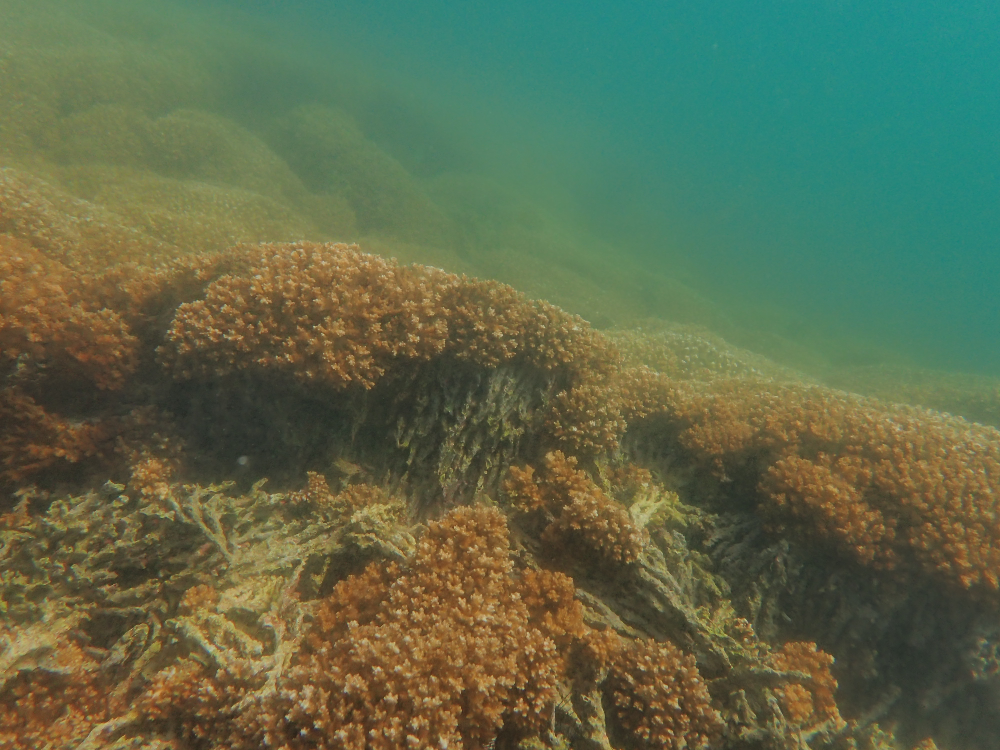

***

### Published:

2026	(13) Chang, E.S., **Connelly, M.T.**, Travert, M. Barreira, S.N., Rivera, A.M., Katzer, A.M., Yu, R., Cartwright, P., Baxevanis, A.D. “A chromosome-level reference genome for the colonial marine hydrozoan Podocoryna americana” G3: Genes, Genomes, Genetics https://doi.org/10.1093/g3journal/jkag160 co-first authors

2025 	(12) **Connelly, M.T.**, Glynn, V.M., Cornejo, A., Villalobos-Cubero, T., Kleypas, J., Alvarado, J.J., Brandt, M., Logan, C.A., Palacio-Castro, A.M., Flot, J-F., Leray, M., Connolly, S.R., Quattrini, A.M. “Genome skimming illuminates hidden species diversity and Symbiodiniaceae associations in east Pacific Pocillopora corals” Genome Biology and Evolution https://doi.org/10.1093/gbe/evaf235 

2024	(11) McRae, C.J., Holloway, N., Chen. G., **Connelly, M.T.**, et al. “Groundtruthing assessments of lab-based coral thermal tolerance with large-area imaging” Coral Reefs https://doi.org/10.1007/s00338-024-02582-w

2024	(10) **Connelly, M.T.**, Catapang, M.G. and Quattrini, A.M. “Unlocking the treasure trove: leveraging dry coral specimens for museum genomics” Coral Reefs https://doi.org/10.1007/s00338-024-02525-5 

2023	(9) **Connelly, M.T.**, Snyder, G.A., Palacio-Castro, A.M., Gillette, P.R., Baker, A.C. and Traylor-Knowles, N.T. “Antibiotics reduce Pocillopora coral-associated bacteria diversity, decrease holobiont oxygen consumption, and activate immune gene expression” Molecular Ecology 32 (16), 4677-4694 https://doi.org/10.1111/mec.17049 

2022	(8) **Connelly, M.T.**, McRae, C.J., Liu, P.J., Martin, C.E. and Traylor-Knowles, N.T. “Antibiotics Alter Pocillopora Coral-Symbiodiniaceae-Bacteria Interactions and Cause Microbial Dybiosis During Heat Stress” Frontiers in Marine Science https://doi.org/10.3389/fmars.2021.814124

2021	(7) Snyder, G.A., **Connelly, M.T.**, Eliachar, S., Girshoni-Yahalom, O., Browne, W.E., Palmer, C.V., Rosental, B., and Traylor-Knowles, N.T. “Functional Characterization of Hexacorallia Phagocytic Cells” Frontiers in Immunology https://doi.org/10.3389/fimmu.2021.662803

2021	(6) Traylor-Knowles, N.T., **Connelly, M.T.**, Young, B.D., Eaton, K., Muller, E., Paul, V.J., Ushijima, B., DeMerlis, A., Drown, M. K., Goncalves, A., Kron, N., Martin, C.E., and Rodriguez, K. “Gene Expression Response to Stony Coral Tissue Loss Disease Transmission in M. cavernosa and O. faveolata from Florida” Frontiers in Marine Science https://doi.org/10.3389/fmars.2021.681563

2021	(5) Nowotny, J.D., **Connelly, M.T.**, and Traylor-Knowles, N.T. “Novel Methods to Establish Whole-Body Primary Cell Cultures for the Cnidarians Nematostella vectensis and Pocillopora damicornis” Scientific Reports https://doi.org/10.1038/s41598-021-83549-7

2020	(4) Bonacolta, A.M., **Connelly, M.T.**, Rosales, S., del Campo, J., and Traylor-Knowles, N.T. “Microniche sampling of the bacteriome in the Starlet Sea Anemone, Nematostella vectensis, reveals a compartment-specific dominance of Spirochetes” FEMS Microbiology Ecology Letters https://doi.org/10.1093/femsle/fnab002

2020	(3) Walters, B., **Connelly, M.T.**, Young, B., and Traylor-Knowles, N.T. “The Complicated Evolutionary Diversification of the Mpeg-1/Perforin-2 Family in Cnidarians” Frontiers in Immunology (11):1690, https://doi.org/10.3389/fimmu.2020.01690

2020	(2) **Connelly, M.T.**, McRae, C.J., Liu, P.J., and Traylor-Knowles, N.T. “Lipopolysaccharide treatment stimulates Pocillopora coral genotype-specific immune responses but does not alter coral-associated bacteria communities” Developmental and Comparative Immunology (109):103717, https://doi.org/10.1016/j.dci.2020.103717

2017	(1) Traylor-Knowles, N.T. and **Connelly, M.T.** “What Is Currently Known About the Effects of Climate Change on the Coral Immune Response?” Current Climate Change Reports (3):252-260, https://doi.org/10.1007/s40641-017-0077-7

***

{width=800px align="center" style="margin: 5px 5px 5px 0"}

